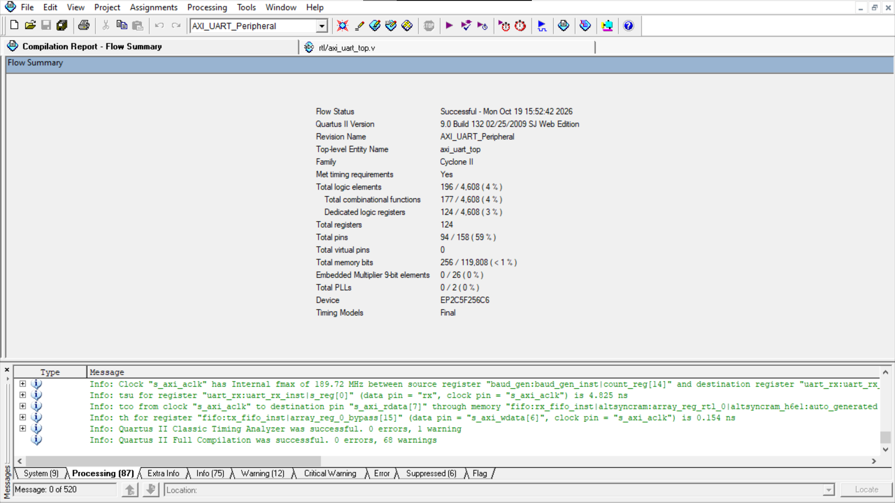
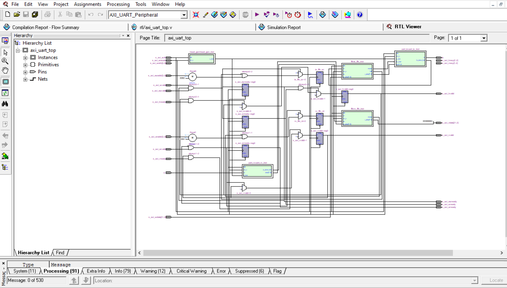
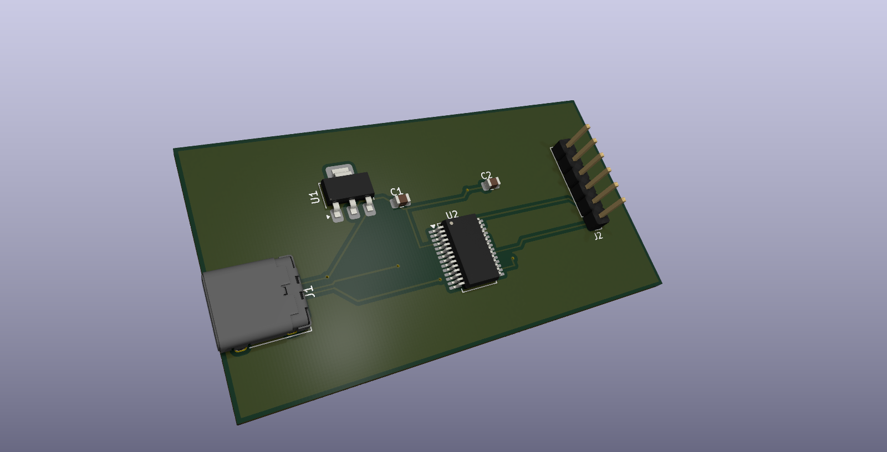
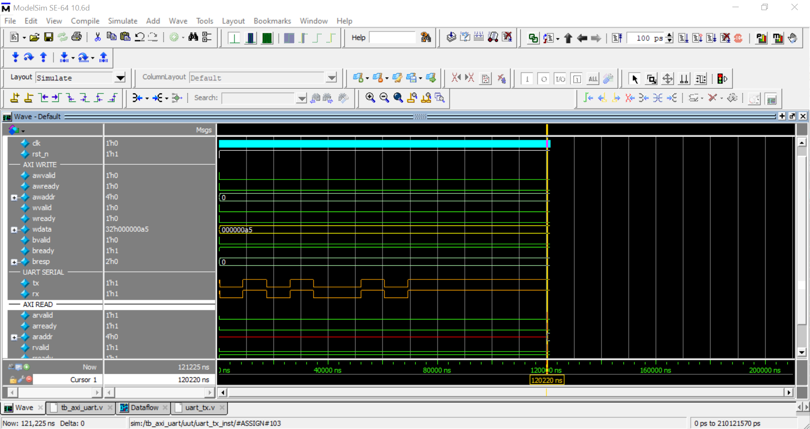
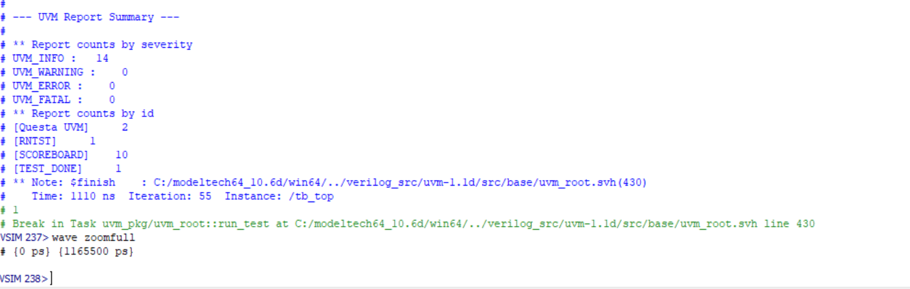

# AXI4-Lite UART IP Core & Custom USB-C to UART PCB

An end-to-end embedded hardware design project combining **Verilog RTL development, FPGA synthesis, simulation-based verification, custom PCB design, and SKY130 ASIC physical implementation**.

The project implements an AXI4-Lite UART IP core with transmit and receive FIFOs, a configurable baud rate generator, a self-checking Verilog testbench and a UVM environment. It also includes a custom two-layer USB-C to UART breakout PCB designed in KiCad 10 around the FT232RL USB-to-UART bridge.

> **Project Status:** FPGA/verification and PCB results are documented below. A separate ASIC RTL snapshot has completed an OpenLane 2.1.11 SKY130A run through GDS, Magic DRC and Netgen LVS, with zero reported setup/hold, slew, fanout, capacitance and antenna violations under the recorded constraints. See [ASIC physical design](physical_design/README.md) for artifacts, evidence and validation limits. Fabrication and hardware validation are pending.

---

## Table of Contents

- [Key Features](#key-features)
- [System Architecture](#system-architecture)
- [RTL Design](#rtl-design)
- [Verification and Simulation](#verification-and-simulation)
- [FPGA Synthesis Results](#fpga-synthesis-results)
- [SKY130 ASIC Physical Design](#sky130-asic-physical-design)
- [Custom USB-C to UART PCB](#custom-usb-c-to-uart-pcb)
- [Visual Showcase](#visual-showcase)
- [Repository Structure](#repository-structure)
- [Getting Started](#getting-started)
- [Current Limitations](#current-limitations)
- [Roadmap](#roadmap)
- [Technologies Used](#technologies-used)
- [License](#license)
- [Author](#author)

---

## Key Features

### FPGA and RTL
- AXI4-Lite slave interface
- UART transmitter and receiver
- Independent TX and RX FIFOs
- Configurable baud rate generator (115200 baud at 100 MHz)
- Modular RTL architecture, targeting Intel Cyclone II

### Verification
- Self-checking Verilog testbench: AXI write, UART TX, loopback, RX FIFO, AXI read-back (test byte `8'hA5`)
- Comparing UVM scoreboard; normal loopback, reset recovery and read/write response backpressure tests
- Standalone FIFO reference-queue checks; recorded ModelSim results linked below

### PCB Design
- Custom 2-layer USB-C to UART breakout board (65 x 35 mm)
- FT232RL USB-to-UART bridge and AMS1117-3.3 regulator
- GND planes on both copper layers
- Python-assisted netlist generation, placement and design rules
- Freerouting auto-routing, KiCad DRC with 0 errors, 3D visualization

---

## System Architecture

```text
             AXI4-Lite Master
                    |
                    v
          +--------------------+
          |  AXI4-Lite Slave   |
          |  Register Interface|
          +--------------------+
                    |
          +---------+---------+
          |                   |
          v                   v
   +-------------+     +-------------+
   |   TX FIFO   |     |   RX FIFO   |
   +-------------+     +-------------+
          |                   ^
          v                   |
   +-------------+     +-------------+
   |  UART TX    |     |  UART RX    |
   +-------------+     +-------------+
          |                   ^
          v                   |
        TX Pin              RX Pin

          +------------------+
          |  Baud Generator  |
          +------------------+
```

**Transmit path:** AXI4-Lite write, TX FIFO, UART transmitter, TX serial output.

**Receive path:** RX serial input, UART receiver, RX FIFO, AXI4-Lite read.

**Loopback:** in simulation, the TX output is connected to the RX input to verify that transmitted data is received correctly.

---

## RTL Design

| Module | Responsibility |
|---|---|
| `axi_uart_top.v` | Top-level integration and AXI4-Lite interface |
| `uart_tx.v` | UART serial transmission |
| `uart_rx.v` | UART serial reception |
| `baud_gen.v` | Baud timing generation |
| `fifo.v` | Data buffering (8-bit, 16 entries) |
| `tb_axi_uart.v` | Self-checking simulation testbench |

| Parameter | Value |
|---|---|
| Reference clock | 100 MHz |
| Baud rate | 115200 |
| AXI data width | 32 bit (UART data on bits [7:0]) |
| FIFO | 8-bit data, 16 entries |
| FPGA family | Intel Cyclone II |

---

## Verification and Simulation

### Verilog testbench

| Test | Objective |
|---|---|
| AXI write | Write a byte through the AXI4-Lite bus |
| UART TX | Verify serial transmission |
| Loopback | Verify transmitted and received data match |
| RX FIFO | Verify received data buffering |
| AXI read-back | Read the byte back through the bus |

Expected output:

```text
[TB SUCCESS] Loopback Data Matched: 0xa5
```

### Checked UVM tests — 22 November 2026

The scoreboard now compares expected transmitted bytes against AXI RX read-back data, rather than only printing monitored writes.

| Test | Observed result | Evidence |
|---|---|---|
| Normal loopback | 10 writes, 10 reads, 10 matches | [Log](results/loopback.log) |
| Reset during UART transmission | Interrupted byte discarded; 10 subsequent transfers match | [Log](results/reset.log) |
| Read response backpressure | RREADY delayed 5 cycles; response stable, 10 matches | [Log](results/read_backpressure.log) |
| Write response backpressure | BREADY delayed 5 cycles; response stable, 10 matches | [Log](results/write_backpressure.log) |
| Standalone FIFO, SystemVerilog | 662 cycles, 298 data comparisons; full/empty, overflow attempts, wraparound, reset and random operations | [Log](results/fifo.log) |

All four UVM runs reported zero UVM_ERROR and UVM_FATAL. These are console excerpts from ModelSim SE-64 10.6d runs performed by Hanane Aouragh and supplied with the source archive; they were not rerun in the publication environment.

**Bug found and fixed:** delaying RREADY exposed a direct connection from RX FIFO output to RDATA. Popping the FIFO changed the response before acceptance. The RTL now holds read data in a register and blocks another read while a response is pending. The same test changed from 10 mismatches and 50 stability errors to 10 matches and zero errors. [Before-fix evidence](results/read_backpressure_before_fix.log).

### Running the simulations

In the ModelSim Transcript, change to the repository root. Run each command separately, waiting for its report before starting the next:

```tcl
do run_uvm.do
do run_reset.do
do run_backpressure.do
do run_write_bp.do
do run_fifo.do
```

The scripts compile the required sources and save timestamped console logs and wave databases in `results/`. The UVM scripts use ModelSim's installed UVM library. The new FIFO runner wraps the supplied standalone testbench and has not itself been executed in ModelSim here.

---

## FPGA Synthesis Results

**Historical results for the earlier RTL revision. Synthesis and timing analysis have not been repeated after the November read-response fix.**

Synthesized for the Intel Cyclone II `EP2C5F256C6` with Quartus II.

| Parameter | Result |
|---|---:|
| Logic Elements | 196 / 4,608 (about 4%) |
| Registers | 124 |
| Maximum Frequency (Fmax) | 189.72 MHz |

The Fmax value is a synthesis timing-analysis result for the configured design and constraints; it has not been validated on hardware.

---

## SKY130 ASIC Physical Design

The UART ASIC implementation uses **OpenLane 2.1.11, OpenROAD, KLayout, Magic and Netgen**, targeting **sky130A / sky130_fd_sc_hd** with a 10 ns clock constraint. The recorded final run reports **Magic DRC = 0, LVS errors = 0, antenna = 0, max slew/fanout/capacitance violations = 0**, and zero setup/hold violations across nine analyzed timing corners. Worst setup slack is **+2.2284 ns**, and worst hold slack is **+0.0300 ns**.

[Physical design documentation, compressed GDS, implementation netlist and reports](physical_design/README.md).

The ASIC RTL snapshot includes an RX synchronizer and is stored separately from the FPGA sources. The earlier UVM regression is not evidence for this ASIC revision; its supplied functional evidence is the single-byte loopback log. CDC/reset constraint review, broader regression and fabrication remain outside this recorded run.

---

## Custom USB-C to UART PCB

| Ref | Component | Function |
|---|---|---|
| J1 | USB-C receptacle | USB connection and power input |
| U2 | FT232RL | USB-to-UART conversion |
| U1 | AMS1117-3.3 | 3.3 V regulation |
| C1, C2 | SMD capacitors | Decoupling |
| J2 | 1x6 pin header | UART connection to the FPGA board |

### Design workflow

1. Netlist generation with Python (`make_netlist.py`)
2. Board outline, placement, design rules and GND planes scripted with KiCad's Python API
3. Auto-routing with Freerouting (Specctra DSN/SES exchange)
4. KiCad DRC: 0 errors
5. 3D visualization with component models

---

## Visual Showcase

### 1. FPGA Synthesis Report (Quartus II)


### 2. RTL Architecture (Quartus RTL Viewer)


### 3. Custom USB-C to UART PCB (KiCad 10, 3D render)


### 4. Simulation Waveform (ModelSim SE-64)


### 5. Historical UVM Report Summary (earlier environment)

This earlier screenshot predates the comparing scoreboard. Use the linked November logs above for the current validation results.


---

## Repository Structure

```text
.
├── rtl/       Verilog sources and testbench
├── sim/       UVM environment and standalone FIFO test
├── results/   Supplied console evidence
├── run_*.do   ModelSim runners
├── pcb/       KiCad project and Python scripts
├── docs/      Screenshots
├── LICENSE
└── README.md
```

---

## Getting Started

### Requirements

- Intel Quartus II (Cyclone II support)
- ModelSim (Verilog and SystemVerilog/UVM)
- KiCad 10
- Freerouting
- Python (KiCad scripting console)

### Clone

```bash
git clone https://github.com/hananeaouragh-ops/axi-uart-fpga-usbc-board.git
cd axi-uart-fpga-usbc-board
```

### Open the PCB project

1. Open the `.kicad_pro` file in `pcb/` with KiCad 10.
2. Inspect the layout, run DRC and open the 3D viewer.

---

## Current Limitations

- The UVM environment is a first version: limited stimulus, no functional coverage yet.
- AXI4-Lite protocol compliance has not been checked exhaustively.
- The PCB has not been fabricated, and no physical UART communication has been tested.
- Fmax comes from the earlier RTL revision's timing analysis, not hardware measurements or the updated RTL.
- Current AXI write tests issue AW and W together, one transfer at a time. Independent channel timing, multiple pending writes and WSTRB handling are not validated; the RTL currently ignores WSTRB.
- Full-FIFO behavior was tested on the standalone FIFO, not at UART integration level. These tests are not exhaustive AXI compliance or functional coverage closure.
- ASIC synthesis and physical implementation now have recorded results in `physical_design/`. ASIC CDC/reset constraint review and broader regression remain pending; DFT and hardware validation have not been performed.

---

## Roadmap

- [x] Verilog RTL and self-checking testbench
- [x] FPGA synthesis (Cyclone II)
- [x] UVM environment (driver, monitor, scoreboard)
- [x] PCB layout, routing and DRC
- [x] SKY130 ASIC run through GDS, Magic DRC and Netgen LVS
- [ ] ASIC CDC/reset constraint review and broader functional regression
- [ ] Add functional coverage and more UVM sequences
- [x] Standalone FIFO boundary tests and UART reset recovery
- [x] Read/write response backpressure tests (5-cycle delays)
- [ ] UART integration with full TX/RX FIFOs and broader AXI traffic
- [ ] Generate manufacturing files (Gerber, drill, BOM) and fabricate the PCB
- [ ] Hardware test: UART loopback and FPGA-to-PC communication

---

## Technologies Used

| Category | Technologies |
|---|---|
| RTL Design | Verilog HDL |
| Bus Interface | AXI4-Lite |
| Simulation / Verification | ModelSim, Verilog testbench, SystemVerilog UVM |
| FPGA | Intel Quartus II, Cyclone II |
| PCB Design | KiCad 10, Freerouting |
| Automation | Python |

---

## License

Released under the MIT License (see [LICENSE](LICENSE)).

---

## Author

**Hanane Aouragh**

Embedded Systems | FPGA Design | Digital Hardware | PCB Design

