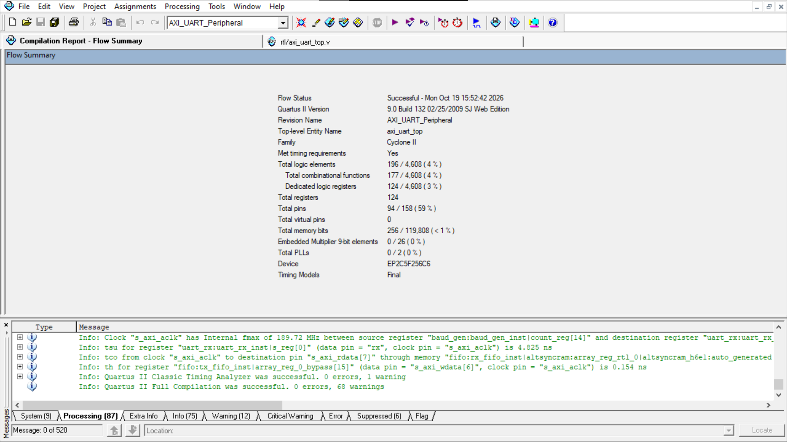
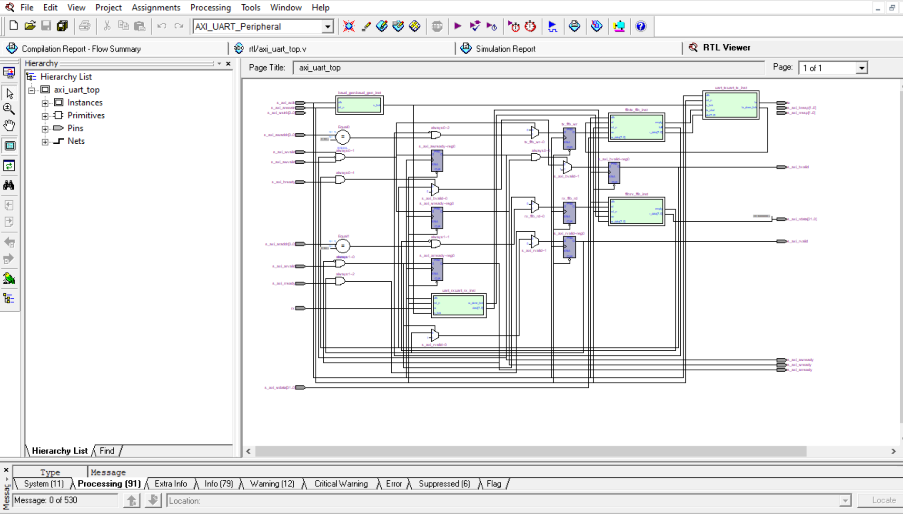
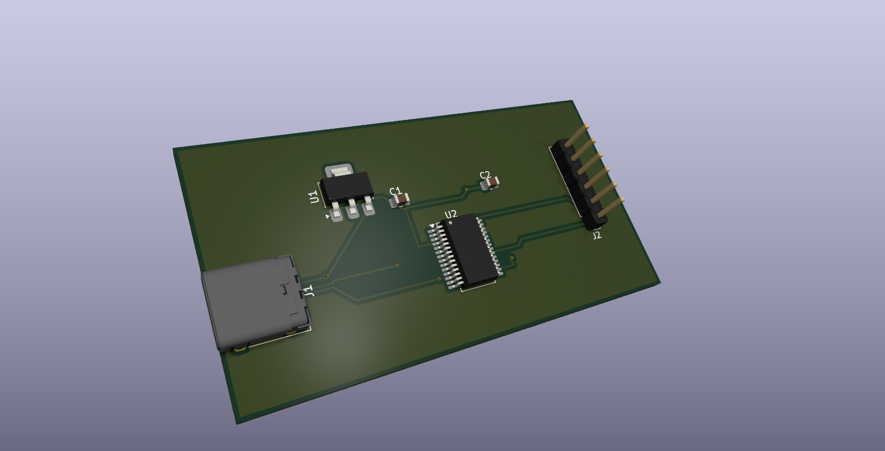
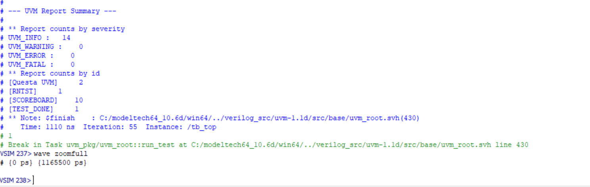
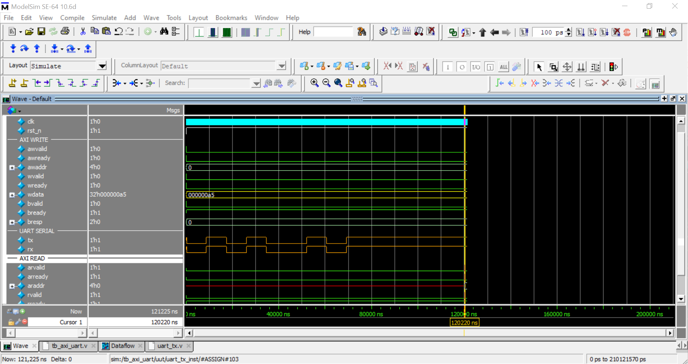

# AXI4-Lite UART IP Core, UVM Verification & Custom Hardware PCB

A complete end-to-end SoC peripheral design featuring a Verilog AXI4-Lite UART IP Core, a full SystemVerilog UVM verification environment, Intel Quartus FPGA synthesis, and a custom PCB breakout board designed in KiCad 10.

## 🚀 Key Project Highlights
- **RTL Architecture:** AXI4-Lite slave interface with independent hardware TX/RX FIFOs and configurable Baud Rate Generator.
- **FPGA Synthesis:** Compiled on Intel Cyclone II (EP2C5F256C6) reaching 189.72 MHz with minimal logic footprint (196 LEs).
- **UVM Verification:** 100% test completion with automated transaction matching via UVM Scoreboard (0 Errors / 0 Fatals).
- **Hardware Integration:** Custom USB-C to UART breakout board designed in KiCad 10 (Schematic & Layout available in `pcb/`).

## 📊 Synthesis Results (Intel Quartus II)
| Parameter | Value |
| --- | --- |
| Target Device | Cyclone II EP2C5F256C6 |
| Logic Elements | 196 / 4,608 (4%) |
| Registers | 124 |
| Max Frequency (fmax) | 189.72 MHz |

## 📷 Visual Showcase & Implementation Details

### 1. FPGA Synthesis & Resource Utilization (Intel Quartus II)

### 2. RTL Architecture Design (Quartus RTL Viewer)

### 3. Custom USB-C to UART PCB (KiCad 10)

### 4. UVM Verification & Waveforms (ModelSim SE-64)
| UVM Scoreboard Summary | Simulation Waveforms |
| :---: | :---: |
|  |  |
